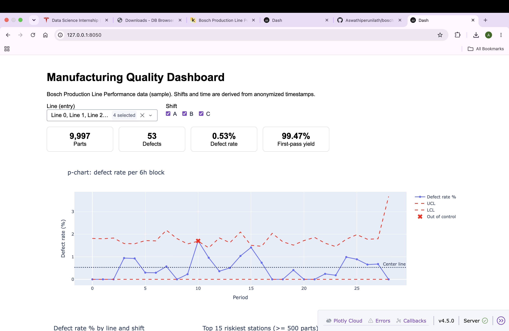
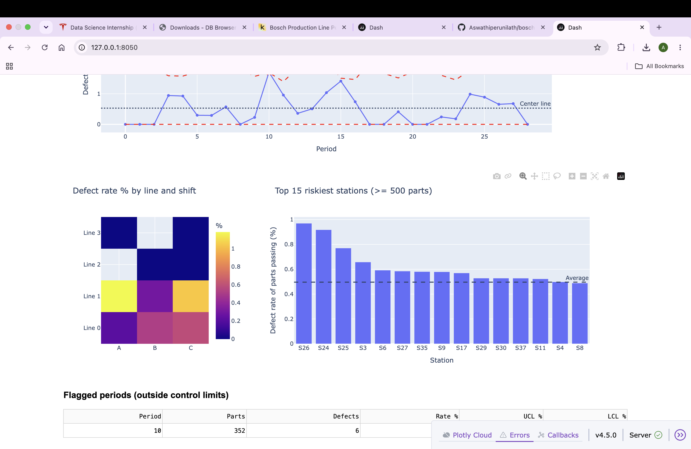
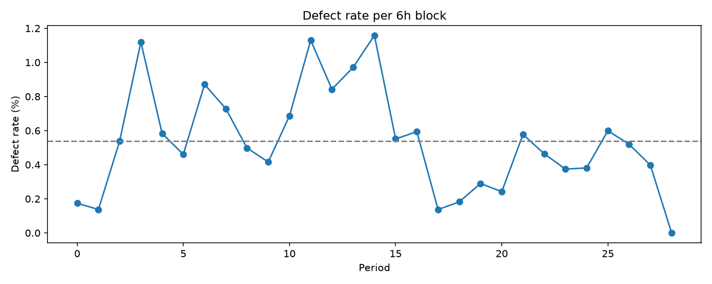

[# Manufacturing Quality Dashboard (Bosch Production Line Data)

## Problem
Where and when do quality problems occur in production, and which stations deserve investigation?

## Data
Bosch Production Line Performance (Kaggle). I used a sample of [N] parts.
**Assumptions:** line = the line where a part first entered production.
Shifts (A/B/C) and 6-hour periods are derived from anonymized timestamps, so they are illustrative, not real shifts.

## Architecture
Kaggle zips -> Python ETL (pandas) -> SQLite -> SQL analysis -> Dash/Plotly dashboard

## Key findings
- [Finding 1 from your SQL, e.g. "Line X / shift Y has the highest defect rate: Z%"]
- [Finding 2, e.g. "Station S has a lift of N vs. the overall defect rate"]
- [Finding 3, e.g. "N periods fell outside the p-chart control limits"]

## Screenshots

## How to run
1. Download `train_numeric.csv.zip` and `train_date.csv.zip` from Kaggle into `data/raw/`
2. `python3 -m venv .venv && source .venv/bin/activate`
3. `pip install -r requirements.txt`
4. `python etl.py`
5. `python app.py` and open http://127.0.0.1:8050

## Methods
- ETL with chunked processing, validation checks and logging
- SQL: window functions, rolling averages, ranking
- Anomaly flagging: p-chart (3-sigma control limits)
- Note: station "defect rate" means the share of parts passing a station that later failed final test. It is a risk indicator, not proof of cause.

## Next steps
PostgreSQL, scheduled ETL, Isolation Forest anomaly detection, Docker deployment.]
